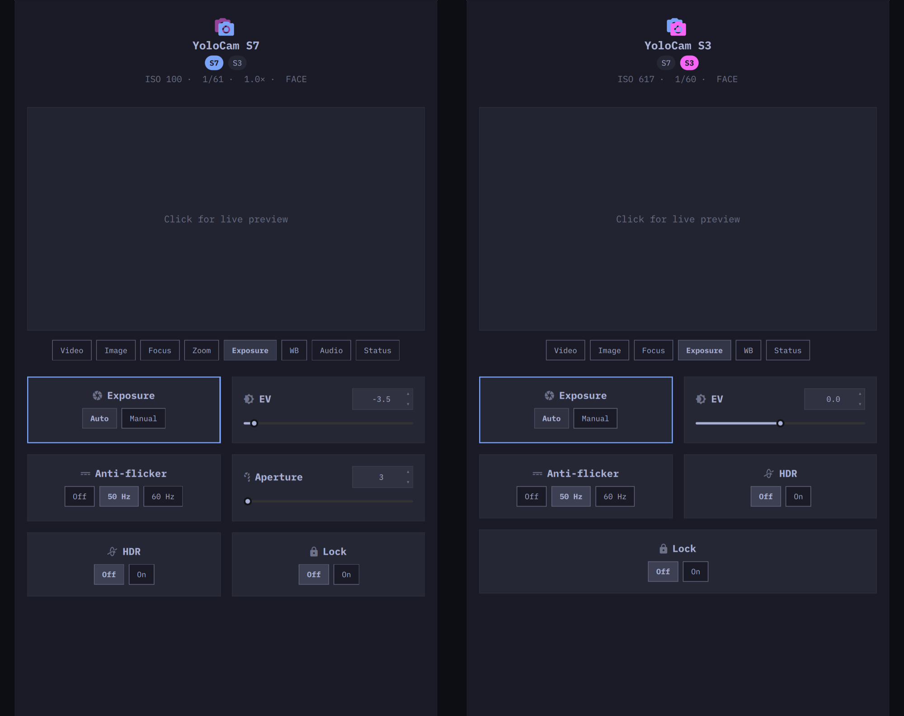
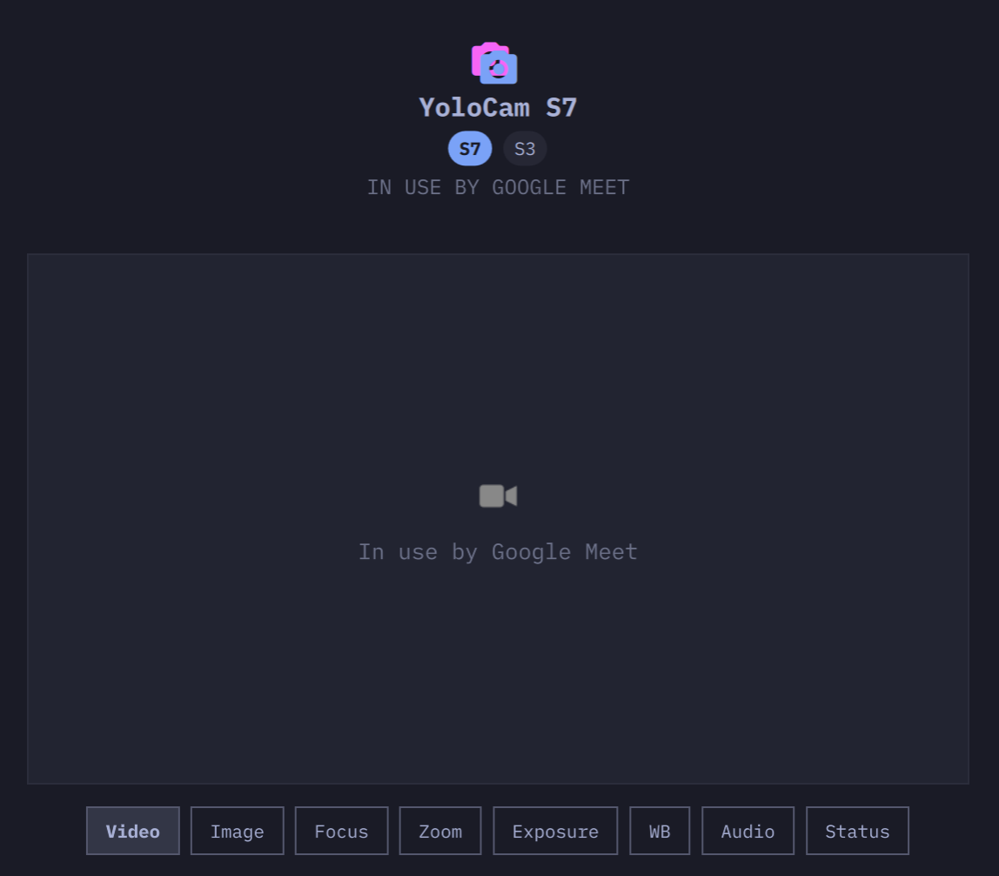
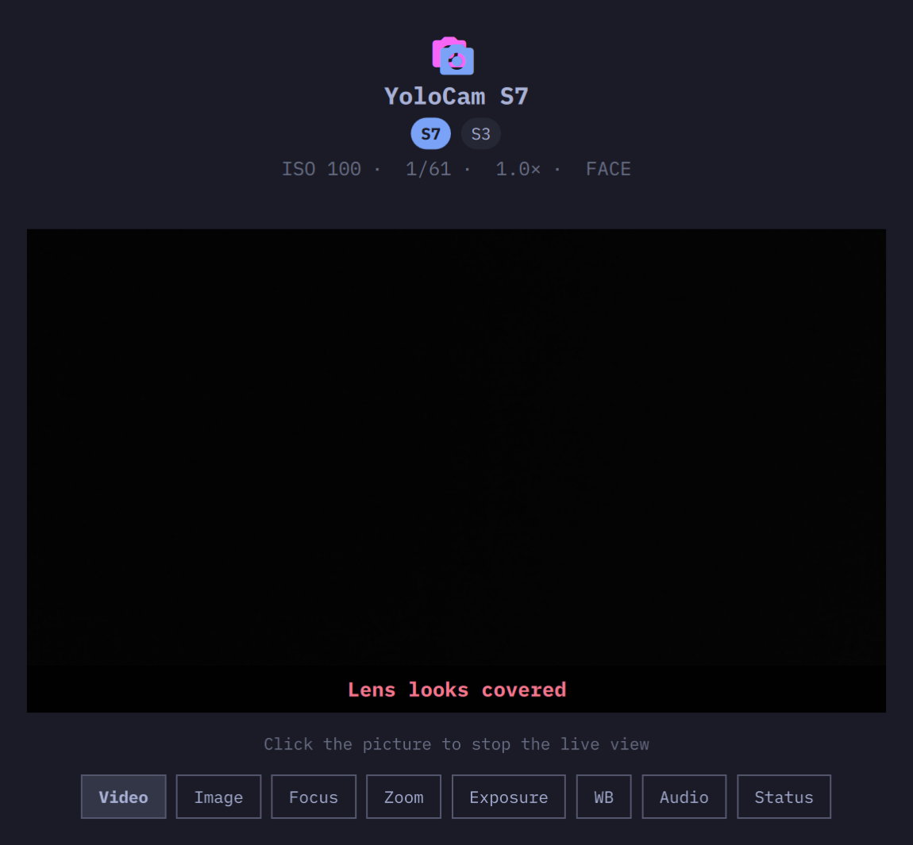
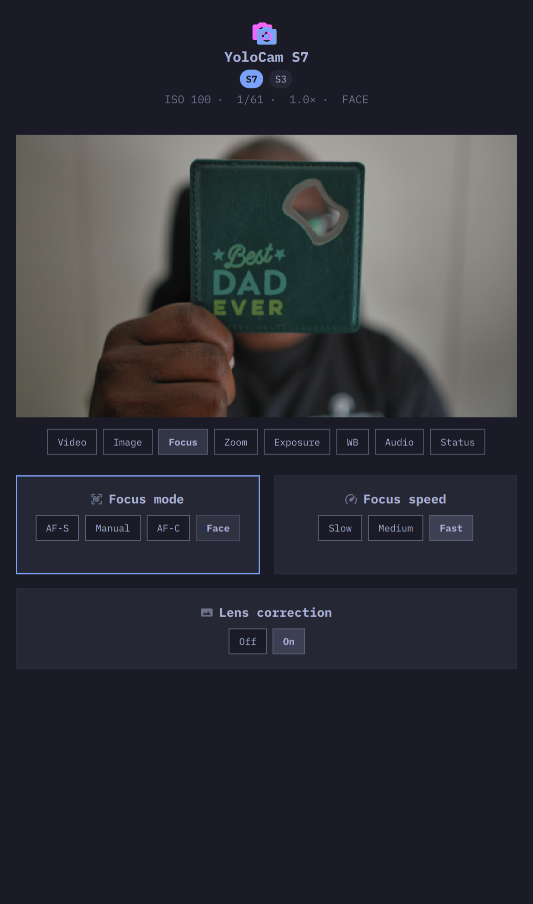

# CamY

The unofficial Omarchy configurator for [YoloLiv](https://www.yololiv.com/) YoloCam [**S7**](https://www.yololiv.com/yoloCam-s7) and [**S3**](https://www.yololiv.com/yoloCam-s3) — similar to the [Compose](https://www.yololiv.com/compose-app) app on Windows and Mac. Without CamY, Omarchy users who own these brilliant cameras would need to connect to spare Windows or Apple devices just to change camera settings.

CamY is not affiliated with, endorsed by, or sponsored by YoloLiv Inc. YoloCam, YoloLiv, and Compose are trademarks of their owners.



This page is the user guide for installation, first run, and everyday use. How the helper is built and released lives in [CONTRIBUTING.md](CONTRIBUTING.md) and [docs/RELEASING.md](docs/RELEASING.md). Control-channel parameters live in [docs/protocol.md](docs/protocol.md).

Firmware flashing, CLUT colour-wheel upload, and YoloLiv remote assistance are out of scope for now.

## Install

Omarchy 4 on x86_64 and aarch64. Plugins run unsandboxed inside `omarchy-shell`; read the code before you enable it.

```sh
omarchy plugin add https://github.com/t-zero-dev/camy.git --enable
```

That clones the plugin, enables the **service** (USB + control) and the **window**, and on first open downloads the pinned helper from GitHub Releases, checks its sha256, and installs it under `~/.local/share/camy/bin`. The same bootstrap writes the Apps launcher entry and Hyprland rules so the window opens floating, centred, and 720×min(1220, 90% of the monitor). Super+T still toggles float for other windows; on CamY it only recentres. Open from **Apps → CamY**.

Optional: a Hyprland key. Add one line to `~/.config/hypr/bindings.lua`. Example, Super+Shift+C:

```lua
o.bind("SUPER + SHIFT + C", "CamY", "omarchy-shell shell toggle io.github.t-zero-dev.camy '{}'")
```

Configs inside the plugin and outside it are listed in [docs/configuration.md](docs/configuration.md).

## First run

Plug the camera with the original USB 3 **data** cable (HDMI-only is not a control path). Open **Apps → CamY**, or:

```sh
omarchy-shell shell toggle io.github.t-zero-dev.camy '{}'
```

The glyph is an outline camera until USB shows up, then fills, then accented (blue for S7, cyan for S3) when the control plane is up. Click the preview pane, or press Space, for a 1280×720 preview. Click again (or Space) to stop. Preview stops when the window closes. You cannot stop the preview from the Focus tab.

If OBS, Meet, or Zoom already holds the UVC node, preview says busy and names the holder when it can. The rest of the window still works.



With both an S7 and an S3 docked, select the body under the title, or press `[` `]`. A second body of the same model is ignored.

## The window

The preview pane stays above the cards. 16:9 / 9:16 rotates the **preview only** — it is not written to the camera. Vertical flip is S7-only and also preview-only.

Tabs, left to right:

| Tab | What is on it |
| --- | --- |
| Video | Orientation, frame rate, resolution (USB), vertical flip (S7), HDMI colour, HDMI output |
| Image | Sharpness, contrast, saturation, brightness, dynamic range, hue, gamma, vignette |
| Focus | Mode, speed, AF area or manual focus, lens correction |
| Zoom | 1.0×–4.0× (optical on S7, digital on S3) |
| Exposure | Auto/manual, EV or ISO/shutter, anti-flicker, aperture, HDR, lock |
| WB | Auto/manual, temperature, tone, picker, red/blue offset, lock |
| Audio | Volume, delay, Line/Mic, auto gain, noise cancellation (S7 only) |
| Status | Model, firmware, serial, control IP, UVC node, lens — Refresh only |

Image has eight cards; on a short laptop window the list scrolls. Tab and arrows keep the selected card on screen.

A covered lens paints an overlay on the preview. ISO, shutter, zoom, and focus under the title stay visible. Hover those readouts for a one-line gloss.



**AF-S** — click the preview to pick a point.

**AF-C** — Large / Medium / Small, or Custom and drag a box.

**Face** — tracks a face.



**Audio on S7** — a wireless receiver belongs on **Line**, not Mic. Volume around 40–50, auto gain off if the transmitter already has gain. Noise cancellation indoors can add grain.

## Keyboard shortcuts

The window is one Tab stop. Cards accept Tab; chips inside a card accept Enter or left/right.

| Key | Action |
| --- | --- |
| Tab / Shift+Tab | Next / previous card |
| `h` `j` `k` `l` or arrows | Nudge a value, or move card (up/down) |
| Shift+left / Shift+right | Larger nudge |
| Enter | Activate (toggle a two-way chip, or focus a number box) |
| 0–9 | Type into the selected slider |
| Space | Start or stop the preview |
| Ctrl+Tab / Ctrl+Shift+Tab | Next / previous tab |
| Ctrl+1 … Ctrl+8 | Jump to a tab |
| `[` `]` | Previous / next camera |
| Alt+1 … Alt+9 | Jump to a camera |
| F5 or Ctrl+R | Refresh (Status tab) |
| Esc | Close, or leave a number box |

On Status, Tab stays on **Refresh**. The readout cards are visible and not selectable.

## Command line

The service runs `camy watch` and **owns** TCP 12345. While the plugin is enabled, talk to that watch. A second `get` / `set` / `probe` / `status` firmware probe opens another client and can stall the camera.

```sh
PLUGIN=~/.config/omarchy/plugins/io.github.t-zero-dev.camy
BIN="${XDG_DATA_HOME:-$HOME/.local/share}/camy/bin/camy"
```

Read state from the shell (JSON: `usb`, `control`, `values`, `selected`, …):

```sh
omarchy-shell camy state
omarchy-shell camy iso 400
omarchy-shell camy zoom 66
omarchy-shell camy focusMode 4
omarchy-shell camy refresh
```

Send JSON to the running watch:

```sh
$BIN ctl set iso 400
$BIN ctl set focus-mode 4
$BIN ctl '{"cmd":"preview","on":true}'
$BIN ctl '{"cmd":"select","model":"s3"}'
```

`$BIN help` lists the rest. `list` prints every named parameter. Full command table: [docs/cli.md](docs/cli.md).

`camy recover` is parked. USB up and control down means power-cycle data **and** power.

## Assistant

A skill teaches Grok (and other agents) to change ISO, zoom, and focus from speech or text. Copy it once:

```sh
PLUGIN=~/.config/omarchy/plugins/io.github.t-zero-dev.camy
mkdir -p ~/.grok/skills/camy ~/.agents/skills/camy
cp "$PLUGIN/skills/camy/SKILL.md" ~/.grok/skills/camy/
cp "$PLUGIN/skills/camy/SKILL.md" ~/.agents/skills/camy/
```

Then: “make the YoloCam brighter by 20%”, “zoom in a bit”, “switch to face detect”.

The agent uses `omarchy-shell camy state` and `$BIN ctl`. It must not run `camy get` / `set` / `status` while the service is up.

## Preferences

There is no `~/.config/camy` file. Enablement lives in Omarchy’s shell config. Window size and keys live in Hyprland. Runtime sockets live under `$XDG_RUNTIME_DIR`.

`~/.config/omarchy/shell.json` is what turns the plugin on:

```json
"plugins": [
  { "id": "io.github.t-zero-dev.camy" }
]
```

The host injects that object as `settings`. One recognised key:

```json
{ "id": "io.github.t-zero-dev.camy", "preview": true }
```

`preview` defaults to `true`. `false` keeps the window and control; Space and click do not start the viewfinder.

Camera values (ISO, shutter, white balance, …) are stored **on the camera**. Closing the window does not revert them.

See [docs/configuration.md](docs/configuration.md) for the Hyprland rules, the desktop entry, the skill copies, and the runtime directory.

## Update

```sh
omarchy plugin update io.github.t-zero-dev.camy
omarchy restart shell
```

Until the restart, the shell keeps running what it loaded at login, old helper pin included. Saving `Panel.qml` can log a plugin reload while the open window still shows the previous QML — restart the shell, then reopen from Apps.

## If something is wrong

If Apps → CamY does nothing after an update, restart the shell.

USB up but control down: the camera’s control process has stalled. Power-cycle data **and** power.

After a screen lock, preview may need a second click. A fully wedged UVC gadget still needs a power cycle.

Meet as a background Chromium tab is named Chromium, not Google Meet.

S3 preview can take several seconds on STREAMON. Wait before clicking again.

The helper is one process started by the service. Its log and the control socket live under `$XDG_RUNTIME_DIR/camy/` (usually `/run/user/<uid>/camy/`). If the helper could not be installed, the reason is `bootstrap.log` in the same directory; opening CamY again retries.

More cases (UVC busy, mixed dock, gadget as default route): [docs/troubleshooting.md](docs/troubleshooting.md).

## Remove

```sh
omarchy plugin remove io.github.t-zero-dev.camy
rm -rf ~/.local/share/camy ~/.cache/camy
rm -f ~/.local/share/applications/camy.desktop ~/.config/hypr/camy.lua
rm -rf ~/.grok/skills/camy ~/.agents/skills/camy
```

If `~/.config/hypr/hyprland.lua` still has a `camy-window-rules` block, delete that block. Super+T then returns to Omarchy’s default toggle.

## Hardware

| | S7 | S3 |
| --- | --- | --- |
| USB VID:PID | `46f8:0851` | `46f8:0855` |
| Gadget | CDC Ethernet | CDC NCM |
| Control | `192.168.129.10:12345` | `192.168.126.10:12345` |

Leave the USB gadget off the default route. One TCP client per camera, 160 ms between RPCs.

## Documentation

| | |
| --- | --- |
| [CLI](docs/cli.md) | Helper and `omarchy-shell camy` |
| [Configuration](docs/configuration.md) | Plugin, shell.json, Hyprland, runtime |
| [Protocol](docs/protocol.md) | Yunxi control channel |
| [Architecture](docs/architecture.md) | Plugin, helper, preview |
| [Troubleshooting](docs/troubleshooting.md) | UVC busy, mixed dock, gadget route |
| [CONTRIBUTING](CONTRIBUTING.md) | Build the helper |

## License

[MIT](LICENSE)
